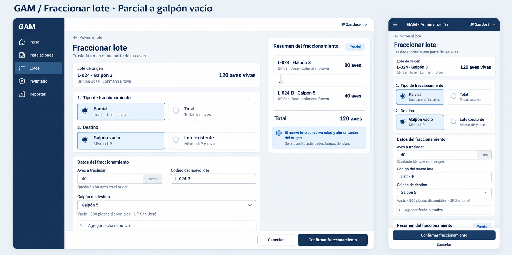
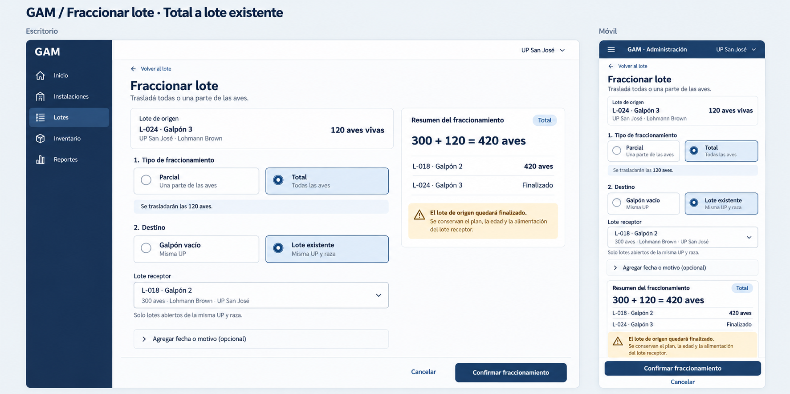

# Fraccionar lote — página propuesta

El detalle del lote presenta una única operación **Fraccionar lote**, en lugar
de Dividir y Agrupar. La página está implementada; ver
[reglas de destinos, capacidad y reintentos](../flock-fractionation.md).
Este diseño sustituye el recorrido anterior con modales.
La etiqueta de alimentación Automático mantiene su diseño celeste actual.

## Diseño





Se propone una página propia, con retorno al lote de origen, contexto de UP,
galpón, raza y aves vivas. Dos grupos de opciones independientes definen el
recorrido: **Parcial / Total** y **Galpón vacío / Lote existente**.

La ruta prevista es `/administracion/lotes/lotes/:id/fraccionar`.
El acceso está habilitado para lotes no finalizados con aves disponibles.

## Comportamiento de las cuatro combinaciones

| Fraccionamiento | Destino | Datos solicitados | Resultado |
| --- | --- | --- | --- |
| Parcial | Galpón vacío | Cantidad menor que el saldo vivo, galpón y código nuevo | Se crea un lote con parte de las aves; el origen conserva el resto. Se conserva edad y alimentación del origen y se copian las actividades futuras del plan. |
| Parcial | Lote existente | Cantidad menor que el saldo vivo y receptor | El origen conserva el resto; se incorporan las aves al receptor sin modificar sus metadatos, edad, modo de alimentación o plan. |
| Total | Galpón vacío | Galpón de destino | Se traslada el mismo lote con todas las aves; conserva identidad y plan. No se pide un código nuevo ni se finaliza el lote. |
| Total | Lote existente | Lote receptor | Se incorporan todas las aves al receptor y se finaliza el origen; prevalecen los datos, edad, alimentación y plan del receptor. |

Todos los destinos pertenecen a la misma UP. Un receptor existente debe estar
abierto y ser de igual raza. El galpón vacío debe estar operativo y sin aves;
los lotes finalizados no lo bloquean. No se considera la capacidad, por indicación
del usuario, aunque esa modificación todavía no esté reflejada en backend.
Las leyendas de plazas disponibles en las imágenes originales ya no aplican.
La validación autoritativa corresponde al servidor.

## Presentación e interacción previstas

- Cantidad editable sólo en Parcial; Total usa las aves vivas vigentes.
- Galpón vacío muestra el selector de galpón. Sólo Parcial pide código nuevo.
- Lote existente muestra búsqueda de receptor y sus aves, galpón y raza.
- El resumen anticipa los saldos y la identidad que queda después de confirmar.
- La finalización del origen se anuncia sólo en Total hacia un lote existente.
- Fecha y motivo son opcionales en un desplegable; no se admite fecha futura.
- Cambiar una opción descarta campos incompatibles y recalcula el resumen.
- Confirmar valida los datos y evita el doble envío; los errores conservan el formulario.
- En móvil, el contenido usa el scroll normal de la página y reserva espacio
  para las acciones inferiores y las áreas seguras. En escritorio, el resumen
  acompaña al formulario en una segunda columna.
- Cancelar o volver retorna al lote, conservando el origen de navegación.
- No se agrega una selección obligatoria de actividad del plan ni se infiere por fecha.

La referencia funcional es `RedistributeFlock` de
`../GAM-Backend/contracts/openapi/lots.yaml`. Los datos de las imágenes son
ejemplos. La implementación futura usará los tokens de `docs/design-colors.md`
para ambos temas; las imágenes muestran el tema claro.

## Generación

El acceso unificado del detalle se verificó contra Docker en el navegador
integrado, en escritorio y teléfono de 320 px, claro y oscuro: un solo botón
de 48 px, sin desbordamientos ni errores de consola. Capturas:
`.tmp/qa/fraccionar-detail-{desktop,mobile}-{light,dark}.png`.
Lint, las 966 pruebas y el build de producción pasaron en Docker.
Estas comprobaciones cubren el detalle; la página de estas imágenes sigue
siendo una propuesta visual.

Herramienta integrada `image_gen`, sin CLI.

Prompts finales utilizados:

### Parcial hacia galpón vacío

```text
Use case: ui-mockup. Generate a polished high-fidelity visual design of a NEW FULL PAGE called "Fraccionar lote" in GAM, the established Spanish Angular Ionic poultry management application. This is a route page, NEVER a modal, no dimmed overlay, no close X. Produce a large landscape presentation image with a desktop page taking about two-thirds width and a phone page taking one-third width, separated by a quiet gutter, labels "Escritorio" and "Móvil". The phone shows responsive version of same state as desktop. This is a practical production UI design, not marketing art. Calm clear typography, legible exact Spanish, strong hierarchy, 11px rounded white cards, simple outlined Ionicons-like icons, no gradients, no photos, no made-up features. GAM light palette: canvas #eef2f6, surfaces #ffffff, secondary surfaces #f7f9fc, headings and action navy #17365d, body #334255, muted #5d6e80, borders #dce3ea, input borders #8091a2, selected radio backgrounds #dce8f4, warning text #8a5a00 on #fff2d6. Desktop existing navy sidebar "GAM", links "Inicio", "Instalaciones", "Lotes" selected, "Inventario", "Reportes"; compact topbar "UP San José". Keep app shell restrained and familiar. Phone compact top bar "GAM · Administración" and menu icon. No new green automatic tag: if showing "Automático", it is navy on pale blue with NO gear icon. Do NOT use Pesaje or Mortalidad. Data are fictional examples. Main page title "Fraccionar lote", back link "Volver al lote", subtitle "Trasladá todas o una parte de las aves." Source context slim white card "Lote de origen" / "L-024 · Galpón 3" / "UP San José · Lohmann Brown" and "120 aves vivas" bold. Below, two radio groups as semantic clearly separate choices with numbered section headings. "1. Tipo de fraccionamiento": radio cards "Parcial" / "Una parte de las aves" and "Total" / "Todas las aves". "2. Destino": radio cards "Galpón vacío" / "Misma UP" and "Lote existente" / "Misma UP y raza". Selected choices have filled navy radio, navy border and pale blue surface, unselected have hollow radio and white surface. Desktop form main column 65% and clearly separate sticky summary right 30%. Mobile same choices stacked as TWO short rows, each row two compact radio tiles side-by-side; conditional fields follow in one column, summary follows form in page scroll. All normal page scrolling, no nested scroll panels. The bottom page action area shows secondary "Cancelar" and navy primary "Confirmar fraccionamiento". On phone sticky footer with a full-width 48px primary and a small text secondary Cancelar below, reserved body space and safe area, no overlapping fields. In desktop action footer follows form content. Keep content well spaced yet concise enough to fit each presentation, with no cropped primary actions. Optional extras closed disclosure row "Agregar fecha o motivo". No technical IDs, API/version values, backend explanations, no wizard or invented required approval checkbox. Precise arithmetic and outcome explanations.
Board heading outside app: "GAM / Fraccionar lote · Parcial a galpón vacío".
State: "Parcial" selected, "Total" unselected; "Galpón vacío" selected, "Lote existente" unselected.
Conditional form fields:
"Aves a trasladar": numeric field value "40", suffix "aves", helper "Quedarán 80 aves en el origen."
"Galpón de destino": dropdown value "Galpón 5", helper "Vacío · 500 plazas disponibles · UP San José".
"Código del nuevo lote": text field value "L-024-B".
Show all three fields clearly; desktop quantity and code can share row if that improves space.
Summary right card heading "Resumen del fraccionamiento"; small badge "Parcial". Two rows "L-024 · Galpón 3" strong "80 aves", "L-024-B · Galpón 5" strong "40 aves". Divider and row "Total" / "120 aves". Optional small branch-arrow icon between origin and outputs. Beneath result simple blue info note "El nuevo lote conserva edad y alimentación del origen." Smaller continuation "Se copian las actividades futuras del plan." This is informational, not amber warning.
Phone same default selected radios and all 3 fields and balance summary with visible full CTA. Place forms slightly compact but never tiny. Do not show receiver selector because new empty house is selected. Do not finalize source. Do not alter the existing app ración tag.
```

### Total hacia lote existente

```text
Use case: ui-mockup. Generate a polished high-fidelity visual design of a NEW FULL PAGE called "Fraccionar lote" in GAM, the established Spanish Angular Ionic poultry management application. This is a route page, NEVER a modal, no dimmed overlay, no close X. Produce a large landscape presentation image with a desktop page taking about two-thirds width and a phone page taking one-third width, separated by a quiet gutter, labels "Escritorio" and "Móvil". The phone shows responsive version of same state as desktop. This is a practical production UI design, not marketing art. Calm clear typography, legible exact Spanish, strong hierarchy, 11px rounded white cards, simple outlined Ionicons-like icons, no gradients, no photos, no made-up features. GAM light palette: canvas #eef2f6, surfaces #ffffff, secondary surfaces #f7f9fc, headings and action navy #17365d, body #334255, muted #5d6e80, borders #dce3ea, input borders #8091a2, selected radio backgrounds #dce8f4, warning text #8a5a00 on #fff2d6. Desktop existing navy sidebar "GAM", links "Inicio", "Instalaciones", "Lotes" selected, "Inventario", "Reportes"; compact topbar "UP San José". Keep app shell restrained and familiar. Phone compact top bar "GAM · Administración" and menu icon. No new green automatic tag: if showing "Automático", it is navy on pale blue with NO gear icon. Do NOT use Pesaje or Mortalidad. Data are fictional examples. Main page title "Fraccionar lote", back link "Volver al lote", subtitle "Trasladá todas o una parte de las aves." Source context slim white card "Lote de origen" / "L-024 · Galpón 3" / "UP San José · Lohmann Brown" and "120 aves vivas" bold. Below, two radio groups as semantic clearly separate choices with numbered section headings. "1. Tipo de fraccionamiento": radio cards "Parcial" / "Una parte de las aves" and "Total" / "Todas las aves". "2. Destino": radio cards "Galpón vacío" / "Misma UP" and "Lote existente" / "Misma UP y raza". Selected choices have filled navy radio, navy border and pale blue surface, unselected have hollow radio and white surface. Desktop form main column 65% and clearly separate sticky summary right 30%. Mobile same choices stacked as TWO short rows, each row two compact radio tiles side-by-side; conditional fields follow in one column, summary follows form in page scroll. All normal page scrolling, no nested scroll panels. The bottom page action area shows secondary "Cancelar" and navy primary "Confirmar fraccionamiento". On phone sticky footer with a full-width 48px primary and a small text secondary Cancelar below, reserved body space and safe area, no overlapping fields. In desktop action footer follows form content. Keep content well spaced yet concise enough to fit each presentation, with no cropped primary actions. Optional extras closed disclosure row "Agregar fecha o motivo". No technical IDs, API/version values, backend explanations, no wizard or invented required approval checkbox. Precise arithmetic and outcome explanations.
Board heading outside app: "GAM / Fraccionar lote · Total a lote existente".
State: "Total" selected with visible "120 aves", "Parcial" unselected; "Lote existente" selected, "Galpón vacío" unselected.
Conditional body: no editable quantity input and NO new code field. A slim line below type group "Se trasladarán las 120 aves."
Receiver searchable dropdown labeled "Lote receptor", selected "L-018 · Galpón 2", secondary "300 aves · Lohmann Brown · UP San José"; helper "Solo lotes abiertos de la misma UP y raza."
Summary right card heading "Resumen del fraccionamiento"; small badge "Total". Bold equation "300 + 120 = 420 aves". Row "L-018 · Galpón 2" / "420 aves". Row "L-024 · Galpón 3" / "Finalizado".
Calm amber warning below summary "El lote de origen quedará finalizado." followed by "Se conservan el plan, la edad y la alimentación del lote receptor." Use warning icon plus text, not red destructive styling.
Phone same selected radios and receiver selector, full balance and outcome warning clearly readable before sticky full CTA. There is room to make this image a little shorter than partial state. No new group identity, no mass multiple-lot selection. Page uses one current origin and one receiver.
```
