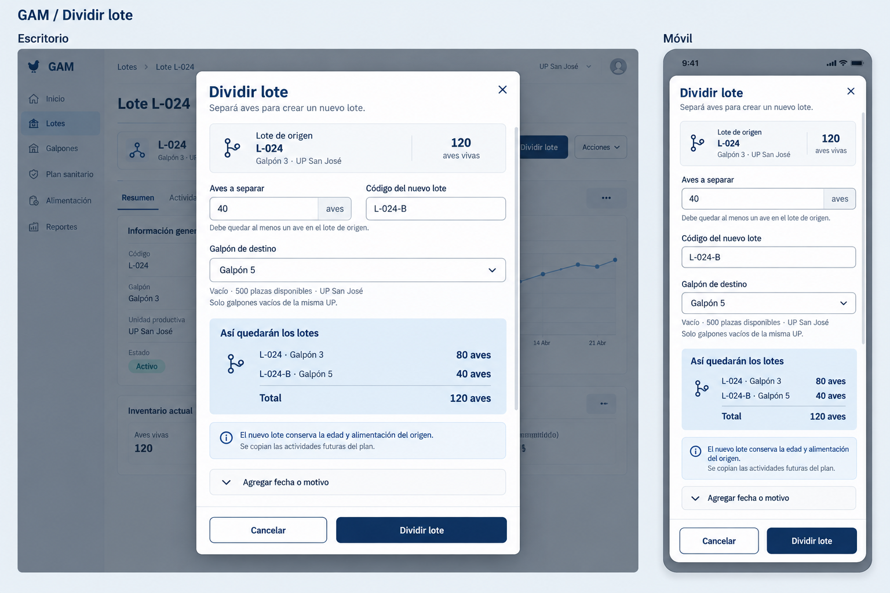
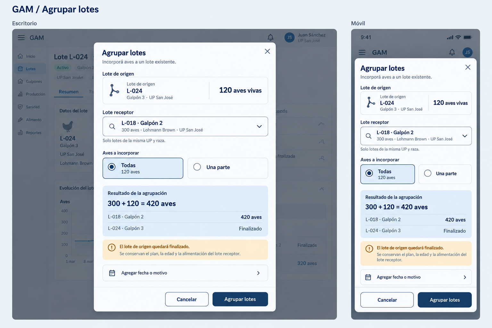

# Modales de operaciones del lote — propuesta visual

Propuesta anterior, sustituida por la [página Fraccionar lote](fraccionar-lote.md).
Se conserva como antecedente de diseño; no representa el recorrido vigente.

Estas imágenes proponen los formularios de Dividir y Agrupar. No se modifica la
implementación de la app ni se habilitan sus botones en este paso.

## Dividir lote



Se elige la cantidad de aves, el código nuevo y un galpón vacío de la misma UP
con capacidad suficiente. El resumen muestra el saldo del origen y del nuevo lote:
120 aves se distribuyen en 80 + 40. El nuevo lote conserva edad y alimentación
del origen y recibe las actividades futuras de su plan.

## Agrupar lotes



Se elige un receptor existente, abierto, de igual raza y de la misma UP.
Se incorporan todas las aves o una parte. El ejemplo muestra todas: 300 + 120 = 420.
La advertencia explica que el origen finaliza, y que prevalecen edad, plan y
alimentación del receptor. Al elegir Una parte debe mostrarse una cantidad
editable y el saldo del origen; en ese caso no se anuncia su finalización.

## Interacción prevista

- Encabezado con cierre, cuerpo desplazable y pie con Cancelar/confirmar.
- Diálogo centrado también en móvil, con márgenes para las áreas seguras.
- Cantidades enteras positivas. Dividir deja al menos un ave en el origen.
- Los destinos dependen de la UP, raza, estado y capacidad; el servidor mantiene
  la validación autoritativa.
- Fecha y motivo son opcionales, detrás de un desplegable. No se admite fecha futura.
- Los errores aparecen junto al campo y conservan las elecciones.
- Al confirmar se impide el envío duplicado y se anuncia el progreso.
- La etiqueta Automático conserva el par celeste actual de GAM.

La propuesta se basa en `RedistributeFlock` y
`POST /flocks/{flock}/redistributions` de
`../GAM-Backend/contracts/openapi/lots.yaml`. La vinculación opcional a una actividad
de manejo se deja fuera del recorrido inicial; no se infiere a partir de la fecha.

Se usan los roles de color de `docs/design-colors.md`. Las imágenes muestran el
tema claro y datos de ejemplo; la futura implementación consumirá los tokens de ambos temas.

## Generación

Herramienta integrada `image_gen`, sin CLI.

Prompts finales utilizados:

### Dividir

```text
Use case: ui-mockup. Create a polished high fidelity UI design image for two responsive presentations of ONE modal in GAM, a real Spanish poultry management Angular/Ionic application. Wide landscape 1536x1024-style canvas. On left, one large desktop modal over a very subtle dimmed crop of an existing lot-detail page. On right, one complete narrower phone modal of the SAME operation, with same fields and example values. Desktop presentation occupies roughly 63%, phone 29%, generous quiet gutters. Both modals should be centered dialogs with bounded scrollable body, top title and X, and always-visible footer actions; no unrelated screen redesign. Mobile must be a centered dialog with 16px safe margins and compact readable layout, not a bottom sheet. Prioritize exact clear Spanish typography, calm production-quality utility UI, generous touch targets 48px, 11px card radius, no fancy marketing decoration, no photos, no glass effects. Palette strictly matches existing GAM light theme: canvas #eef2f6, white surface, #f7f9fc secondary surface, title/action navy #17365d, body #334255, secondary text #5d6e80, decorative border #dce3ea, input borders #8091a2, soft blue #dce8f4. Warnings #8a5a00 on #fff2d6. Outline Ionicons-like icons. Do not use a green Automático tag: if the word Automático is visible anywhere it MUST be navy text on pale blue #dce8f4, never green and no gear icon. No Pesaje or Mortalidad text anywhere. Show labels 'Escritorio' and 'Móvil' above their respective mockups, and a discreet board heading. Do not include code, technical fields, API/ID/version text. All data fictional placeholders. Strong visual hierarchy and data conservation must be obvious, not just a generic form.
Board heading: "GAM / Dividir lote".
Desktop modal exact heading "Dividir lote", subtitle "Separá aves para crear un nuevo lote." Close X at top right with accessible-looking visual.
At top of body compact origin context card with branching outline icon: "Lote de origen" / "L-024" / "Galpón 3 · UP San José" and a strong quantity "120 aves vivas".
Form two columns for desktop, one column mobile:
- numeric input labeled "Aves a separar", value "40", trailing unit "aves"; helper "Debe quedar al menos un ave en el lote de origen."
- text input labeled "Código del nuevo lote", value "L-024-B".
Next full width dropdown labeled "Galpón de destino", selected "Galpón 5", helper "Vacío · 500 plazas disponibles · UP San José". Small helper "Solo galpones vacíos de la misma UP."
A clearly separated soft-blue summary card heading "Así quedarán los lotes" with two rows or a simple equation using clean small branching icon:
"L-024 · Galpón 3" at left and "80 aves" bold right,
"L-024-B · Galpón 5" at left and "40 aves" bold right,
bottom border then "Total" and "120 aves".
Small info callout "El nuevo lote conserva la edad y alimentación del origen." Secondary sentence "Se copian las actividades futuras del plan." Keep concise in mobile by using two short lines.
A closed disclosure row "Agregar fecha o motivo" with downward chevron (optional details collapsed so primary form remains short; don't display irrelevant new fields).
Footer border, outlined "Cancelar" on left, navy filled "Dividir lote" on right. On mobile the two buttons on the same row with large touch targets, footer clear of safe area. Mobile contains ALL primary fields and the full 80+40 balance legibly; do not crop the confirmation button. Body can show tiny subtle scrollbar as indicator. No irreversible warning, no invented required date, no save success modal. Accurate accents and gender, exact numbers.
```

### Agrupar

```text
Use case: ui-mockup. Create a polished high fidelity UI design image for two responsive presentations of ONE modal in GAM, a real Spanish poultry management Angular/Ionic application. Wide landscape 1536x1024-style canvas. On left, one large desktop modal over a very subtle dimmed crop of an existing lot-detail page. On right, one complete narrower phone modal of the SAME operation, with same fields and example values. Desktop presentation occupies roughly 63%, phone 29%, generous quiet gutters. Both modals should be centered dialogs with bounded scrollable body, top title and X, and always-visible footer actions; no unrelated screen redesign. Mobile must be a centered dialog with 16px safe margins and compact readable layout, not a bottom sheet. Prioritize exact clear Spanish typography, calm production-quality utility UI, generous touch targets 48px, 11px card radius, no fancy marketing decoration, no photos, no glass effects. Palette strictly matches existing GAM light theme: canvas #eef2f6, white surface, #f7f9fc secondary surface, title/action navy #17365d, body #334255, secondary text #5d6e80, decorative border #dce3ea, input borders #8091a2, soft blue #dce8f4. Warnings #8a5a00 on #fff2d6. Outline Ionicons-like icons. Do not use a green Automático tag: if the word Automático is visible anywhere it MUST be navy text on pale blue #dce8f4, never green and no gear icon. No Pesaje or Mortalidad text anywhere. Show labels 'Escritorio' and 'Móvil' above their respective mockups, and a discreet board heading. Do not include code, technical fields, API/ID/version text. All data fictional placeholders. Strong visual hierarchy and data conservation must be obvious, not just a generic form.
Board heading: "GAM / Agrupar lotes".
Desktop modal exact heading "Agrupar lotes", subtitle "Incorporá aves a un lote existente." Close X top right.
Origin context compact card with a merging outline icon: "Lote de origen" / "L-024" / "Galpón 3 · UP San José" and strong quantity "120 aves vivas".
Full width searchable dropdown labeled "Lote receptor", selected row "L-018 · Galpón 2" with secondary metadata "300 aves · Lohmann Brown · UP San José" and search icon/chevron. Helper "Solo lotes de la misma UP y raza." Do not show lots from different UP as selectable, do not invent creation of another lot here.
Next form label "Aves a incorporar", two clear side-by-side radio tiles: SELECTED "Todas" with "120 aves", unselected "Una parte". Use navy border, pale blue background and filled radio for selected. Mobile same tiles side-by-side. There is no numeric entry when Todas is selected.
A soft blue balance summary titled "Resultado de la agrupación":
equation "300 + 120 = 420 aves" bold, then row "L-018 · Galpón 2" with strong "420 aves", and second row "L-024 · Galpón 3" with status text "Finalizado".
Below the summary a calm compact amber information callout (important, not red danger): "El lote de origen quedará finalizado." Then explanatory line "Se conservan el plan, la edad y la alimentación del lote receptor." Include tiny navy-on-pale-blue tag "Automático" in the receiver context only if sufficient room; otherwise OMIT entirely. Absolutely no green automatic tag.
Closed disclosure row "Agregar fecha o motivo" with chevron.
Footer border with outlined "Cancelar" and filled navy "Agrupar lotes". On mobile same full primary data and resulting 420 birds and origin finalization, visible footer with big touch targets and safe margin. Balanced modal height, no cropping, avoid tiny or overlapping typography. No irreversible deletion claim, no confirmation checkbox, no multi-source selection or invented new group identity. This operation incorporates the current lot into one existing receiver.
```
