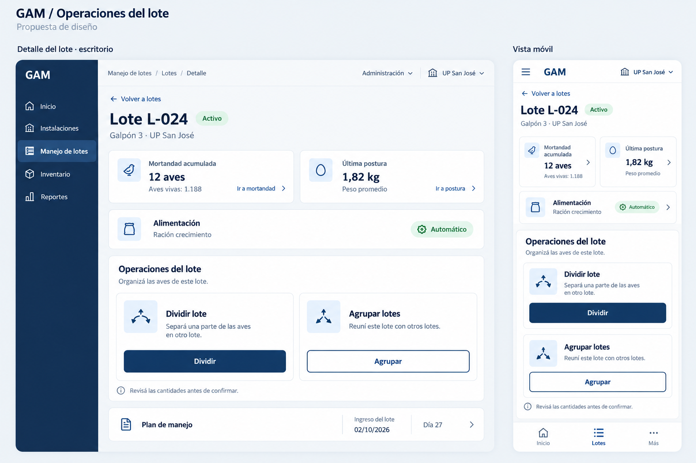

# Operaciones del lote — propuesta visual

El acceso implementado se unificó como **Fraccionar lote**, para un futuro
recorrido en página propia. Ver el [diseño vigente](fraccionar-lote.md).
Las dos tarjetas de la imagen original y sus modales quedaron como antecedentes.



Propuesta de una sección después de Alimentación y antes del Plan de manejo.
Dos accesos: **Dividir lote** y **Agrupar lotes**, contiguos en escritorio y
apilados en teléfono. Cada acceso tiene icono, descripción y botón con texto.
La sección está implementada en el detalle del lote. Los botones se presentan
deshabilitados y se anuncia su disponibilidad próxima mientras se diseñan los
formularios de Dividir y Agrupar. No se envían operaciones al API.
Los datos de la imagen son ejemplos.

La propuesta usa la paleta clara de `docs/design-colors.md`. La implementación
consume los tokens centrales de ambos temas, usa botones de 48 px como mínimo
y mantiene el scroll y las áreas seguras del detalle existente.
La etiqueta de ración **Automático** conserva su diseño celeste actual,
sin adoptar el verde ni el icono de la imagen. **Manual** también conserva su diseño.

En el frontend se cambia la terminología visible a **postura/posturas** y
**mortandad** en lotes, accesos desde galpones, planes de manejo y reportes.
Se conservan las medidas, cálculos, rutas existentes, tipos y endpoints del API.
El catálogo de reportes adapta el nombre de `lots.weighing-measurements` al
presentarlo; no modifica su clave ni su configuración. Los nombres y contenidos
escritos por usuarios y los archivos generados por el backend conservan sus datos.

## Validación de la implementación

La app se levantó con Docker Compose y se probó en el navegador integrado,
con la cuenta local de desarrollo y el lote existente `LOT-FEED-TEST`.
Se verificaron escritorio a 1280 px y teléfono a 320 px, en claro y oscuro:
tarjetas contiguas/apiladas, botones de 48 px deshabilitados, aviso de próxima
disponibilidad, etiqueta Automático celeste y ausencia de desbordamiento horizontal.
No hubo errores de consola. Las capturas están en
`.tmp/qa/flock-operations-{desktop,mobile}-{light,dark}.png`.

Lint, las 966 pruebas de la suite y el build de producción pasaron en Docker.
No se modificó la integración nativa ni se ejecutaron operaciones sobre las aves.

## Generación

Herramienta integrada `image_gen`, sin CLI. Prompt final utilizado:

```text
Use case: ui-mockup. Generate one polished high-fidelity UI design image for GAM, an existing Spanish poultry-management app. Image is a presentation of a proposed NEW section in lot details, not marketing art. Landscape canvas with two clearly labeled panels, a large desktop detail view left (65%) and a complete phone detail view right (30%), separated with generous space. Labels above panels: "Detalle del lote · escritorio" and "Vista móvil". Crisp realistic UI text, elegant readable sans-serif matching Ionic/Angular, simple outline icons, no photography, no gradients, no decorative illustrations, no device chrome obscuring contents. Match established GAM design: page canvas #eef2f6, white cards, title and action navy #17365d, secondary text #5d6e80, body #334255, borders #dce3ea, soft blue #dce8f4, green active badge #176b45 on #e6f5ec. Rounded cards 11px, restrained shadows, orderly spacing. Desktop has narrow navy sidebar with "GAM" and navigation "Inicio", "Instalaciones", selected "Manejo de lotes", "Inventario", "Reportes"; compact top bar "Administración" and "UP San José". Main content breadcrumb "Manejo de lotes / Lotes / Detalle", back link "Volver a lotes", heading "Lote L-024", subtitle "Galpón 3 · UP San José", badge "Activo". Existing summary shown compactly in 2 white cards: "Mortandad acumulada", "12 aves", "Aves vivas: 1.188", link "Ir a mortandad"; and "Última postura", "1,82 kg", "Peso promedio", link "Ir a postura". Important: user requested the visible name postura for existing weight records, retain kg example deliberately. Next full-width white card "Alimentación", "Ración crecimiento", badge "Automático". Focal NEW SECTION below that: heading "Operaciones del lote", helper "Organizá las aves de este lote." Desktop has two equally sized action cards side by side with ample padding, soft blue outline icon tile top left. First icon branching arrows, title "Dividir lote", two lines "Separá una parte de las aves en otro lote.", wide navy button with white text "Dividir". Second icon merging arrows, title "Agrupar lotes", two lines "Reuní este lote con otros lotes.", outlined navy button "Agrupar". Make these primary focal area in image, legible. Under section small neutral note with information outline icon "Revisá las cantidades antes de confirmar." Beneath that a compact "Plan de manejo" row with document icon and chevron, then "Ingreso del lote" / "02/10/2026" / "Día 27". Mobile panel uses same content in vertical layout, title "Lote L-024", smaller active badge, condensed summaries row, alimentation row; NEW "Operaciones del lote" section with two STACKED full width action cards, same titles short helper and buttons >=48px high, comfortably readable without tiny text. Mobile bottom nav icons and labels "Inicio", "Lotes" selected, "Más". All content on phone remains inside safe areas; full action cards and both buttons visible. Top-level title outside UI small "GAM / Operaciones del lote" with subtitle "Propuesta de diseño". Do not draw split/group forms or confirmations because only entry section is being designed. Exact Spanish text with accurate accents. No appearance of the words Pesaje, Pesajes, Mortalidad anywhere. This image is conceptual, all example data are placeholders.
```
