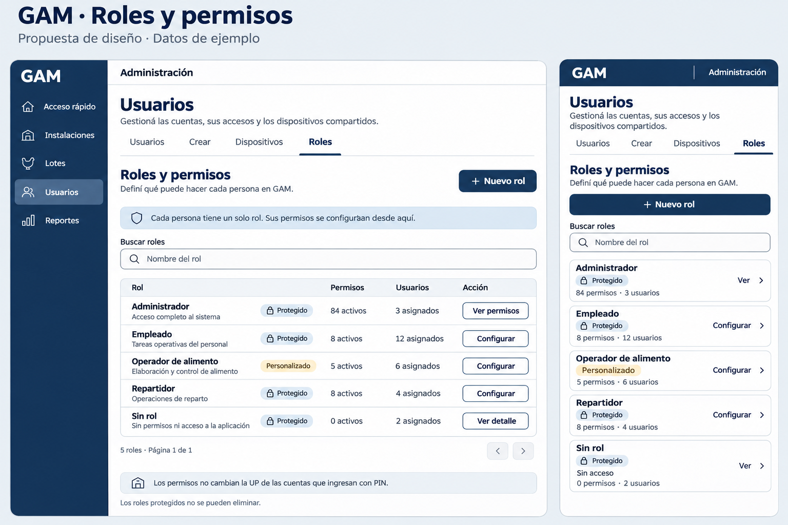
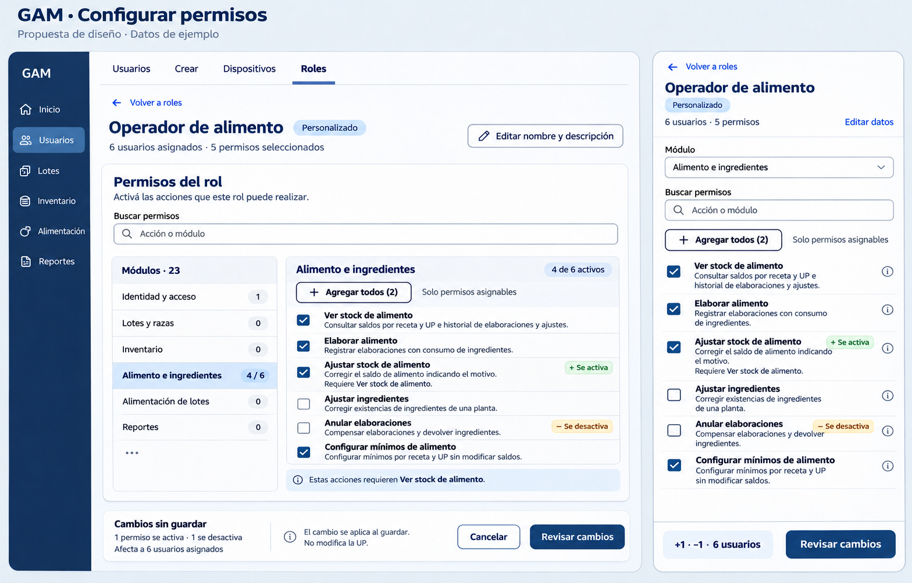
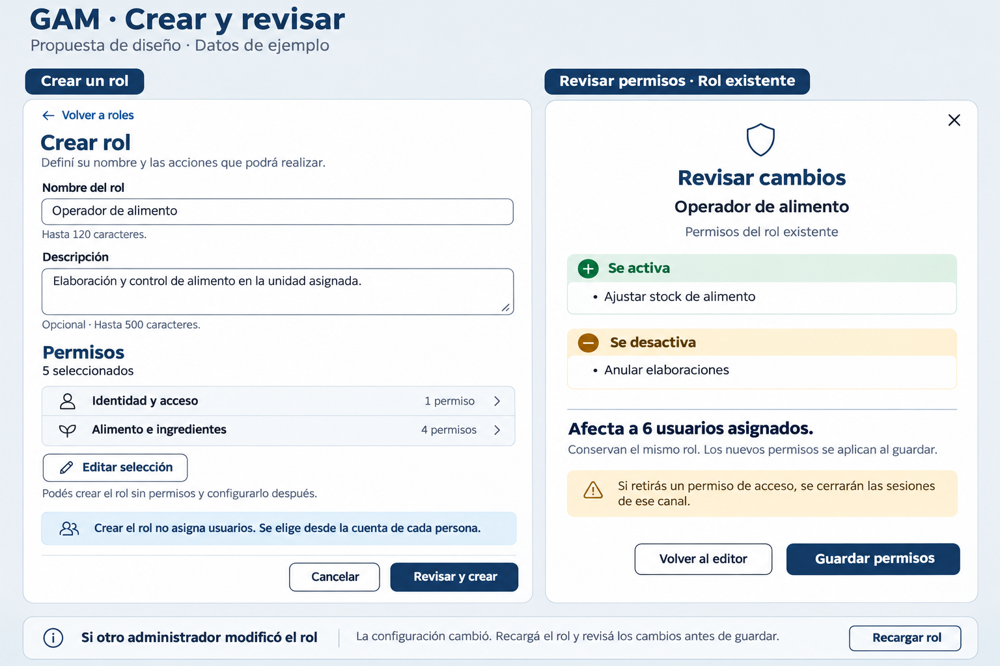

# Roles y permisos — propuesta visual

Estado: diseño implementado en Usuarios → Roles, incluida la acción Agregar todos.
Ver [contratos y comportamiento entregado](../roles-and-permissions.md).
Rama: `rolesyPermisos`. Conserva la estética de la vinculación de dispositivos y los
tokens de `docs/design-colors.md`.

## Láminas







Las cantidades, personas asignadas y el rol personalizado **Operador de alimento**
son ejemplos, no datos extraídos de la base. Los permisos y sus dependencias sí
corresponden al catálogo del backend. Las imágenes se generaron con `image_gen`
integrado, sin CLI; el contrato y los tokens centrales son la referencia exacta
para implementar, por encima de las aproximaciones del bitmap.

## Fuentes revisadas

- `../GAM-Backend/contracts/openapi/authentication.yaml`: catálogo, listado, detalle, alta, edición, permisos, eliminación y asignación.
- `../GAM-Backend/docs/implementations/roles-and-permissions-implementation.md`.
- `../GAM-Backend/docs/implementations/access-methods-and-production-unit-implementation.md`: modalidades, canales, Sin rol y UP.
- `../GAM-Backend/config/permission-catalog.php`: etiquetas, descripciones y dependencias reales.
- `../GAM-Backend/app/Http/Resources/IdentityAndAccess/RoleResource.php`.
- `../GAM-Backend/app/Services/IdentityAndAccess/PermissionCatalog.php`.
- `../GAM-Backend/app/Policies/IdentityAndAccess/RolePolicy.php`.
- `../GAM-Backend/app/Http/Controllers/IdentityAndAccess/RoleController.php` y `UpdateRolePermissionsAction`.

## Reglas que determina la API

Cada persona tiene exactamente un rol y recibe sus permisos efectivos de ese rol.
No hay selección múltiple de roles, permisos individuales, herencia ni creación de permisos
desde la interfaz. Solo Admin activo, con sesión personal, administra estas definiciones.
No se añade un permiso delegable para administrar roles.

Los roles definen acciones y son globales: no llevan un selector de UP. Las cuentas
PIN conservan la restricción de su UP; conceder permisos no cambia esa asignación.
Las modalidades de acceso también se conservan.

| Rol | Configurar nombre/descripción y permisos | Eliminar | Presentación |
| --- | --- | --- | --- |
| Administrador, `admin` | No | No | Protegido; lectura de todos sus permisos. |
| Empleado, `employee` | Sí | No | Protegido; acción Configurar. |
| Repartidor, `delivery` | Sí | No | Protegido; acción Configurar. |
| Sin rol, `unassigned` | No | No | Protegido, sin permisos ni acceso; solo detalle. |
| Personalizado | Sí | Solo sin usuarios asignados | Configurar; eliminar con confirmación cuando corresponda. |

**Protegido** significa que no se puede eliminar, no que todos sus campos sean
inmutables. No se infiere el comportamiento por el nombre visible, que es editable
en los roles admitidos.

El contrato actual documenta 84 permisos en 23 módulos. La pantalla obtiene ambos
del catálogo: no fija esas cantidades ni los nombres de roles en el frontend.
Los números de la lámina son ilustrativos y se sustituyen por los datos devueltos.

## Listado

Se mantiene **Usuarios → Roles**, con título **Roles y permisos** y acción **Nuevo rol**.
La ayuda explica que cada persona tiene un rol y que se configura lo que puede hacer.

Cada fila presenta nombre, descripción, protección, cantidad de permisos activos,
cantidad de usuarios asignados y acceso al detalle o configuración. En teléfono,
las filas pasan a tarjetas táctiles, sin tabla horizontal. La etiqueta Personalizado
usa una superficie neutra o suave, sin comunicar advertencia.

**Buscar roles** consulta `GET roles` con `buscar`, reinicia la paginación y conserva
la búsqueda al volver del detalle. Se muestran totales y páginas solo desde `meta`;
la paginación usa `page` y `por_pagina`. No se inventan filtros remotos por UP,
estado o tipo que el contrato no ofrece.

`usuarios_count` incluye cuentas deshabilitadas. La etiqueta dice **asignados**, no
**usuarios activos**. No se infieren identidades de usuarios desde ese total. Una
respuesta de mutación puede omitir el contador: se recarga el detalle/listado antes
de mostrarlo de nuevo, sin convertir la ausencia en cero.

## Editor

La cabecera presenta nombre, protección/tipo, cantidad de usuarios asignados y total
de permisos seleccionados. **Editar nombre y descripción** abre una operación
separada del editor de permisos.

El catálogo se navega por módulos, con buscador local por etiqueta/descripción y
contador de selección por módulo. En teléfono la navegación lateral pasa a un
selector de módulo. La búsqueda no modifica selecciones ocultas ni el conjunto
completo que se enviará al guardar.

Cada permiso usa una casilla con su etiqueta y descripción. No se muestran campos
editables de módulo, clave técnica o versión. Los identificadores `can_*` se
conservan internamente; las personas ven nombres en español. La ayuda ampliada en
móvil debe estar disponible con toque y teclado, sin depender de hover.

Las dependencias provienen de `requiere`:

- Al activar un permiso que necesita otros, mostrar cuáles se agregarán y pedir
  aceptar esa selección conjunta antes de cambiarla.
- Al desactivar uno requerido por permisos elegidos, explicar cuáles deben
  desactivarse también y permitir confirmar o cancelar el conjunto.
- Nunca guardar una selección inválida, eliminar dependencias silenciosamente ni
  confundir un grupo de navegación con un permiso.
- `asignable: false` se presenta deshabilitado con candado y **Solo Administrador**,
  acompañado de su descripción. No se envía como seleccionable para otros roles.

### Agregar todos los permisos de un módulo

La cabecera del módulo ofrece **Agregar todos (N)** en escritorio y móvil, con
la ayuda **Solo permisos asignables**. N cuenta los permisos asignables del módulo
que todavía faltan en el borrador. La acción conserva las casillas ya elegidas y
agrega las faltantes. Se ofrece tanto al crear como al configurar un rol editable.

La acción toma el módulo completo del catálogo, aunque la búsqueda oculte algunas
filas. Con una búsqueda activa se aclara **Agregar todo el módulo** y se muestra
qué permisos se incluirán antes de aplicar la selección. No modifica otros módulos,
salvo dependencias que se hayan informado y aceptado expresamente.

Se calcula el cierre de dependencias desde `requiere`. Si incluye permisos fuera
del módulo, se enumeran sus etiquetas y módulos para aceptar la incorporación
conjunta o cancelar. Si una dependencia no está disponible o no es asignable,
se explica qué impide completar la selección y no se aplica un resultado parcial
silencioso. Los permisos exclusivos de Administrador quedan fuera de la acción.

Cuando ya están todos los permisos asignables seleccionados, el control queda
deshabilitado con **Todos agregados**. Si el módulo no tiene ninguno asignable,
se explica **Este módulo no tiene permisos asignables para este rol**. Administrador
y Sin rol mantienen sus vistas de lectura, sin esta acción de edición.

Agregar todos solo actualiza el borrador y sus contadores. La revisión existente
presenta los cambios y usuarios afectados; **Guardar permisos** sigue enviando la
selección completa con `version` al mismo endpoint. No se crean permisos ni se
guardan cambios al pulsar la acción del módulo.

La lámina v2 muestra el estado anterior al clic: **4 de 6 activos** y
**Agregar todos (2)**. En este ejemplo se agregarían **Ajustar ingredientes** y
**Anular elaboraciones**. El módulo quedaría con seis seleccionados y el rol con
siete, incluyendo su permiso de canal. Comparado con la configuración original,
el resumen pasaría a dos activaciones y ninguna desactivación, porque Anular
elaboraciones ya estaba habilitado antes de iniciar la edición.

El editor original se conserva como antecedente en `roles-y-permisos-editor.png`;
la propuesta vigente utiliza `roles-y-permisos-editor-v2.png`.

Identidad y acceso distingue los canales web, nativo y compartido de las tareas
de negocio. Sus descripciones explican que un canal no sustituye la modalidad,
el PIN habilitado ni el alcance por UP. Si el borrador retira un canal, la revisión
destaca que se revocarán sus sesiones. Esta advertencia es contextual: no debe
mostrarse como si el ejemplo de alimento retirara un canal.

El ejemplo conserva un permiso de acceso compartido y cuatro de alimento. Activa
**Ajustar stock de alimento** y desactiva **Anular elaboraciones**; sigue teniendo
cinco seleccionados. **Ver stock de alimento** permanece elegido como dependencia.

## Revisión y guardado

**Revisar cambios** muestra, mediante comparación local del original y el borrador,
los permisos que se activan y desactivan y el total de usuarios afectados. No es
un endpoint adicional. Confirma que se conserva el rol de esas personas y que los
cambios se aplican al guardar. Volver al editor mantiene el borrador.

**Guardar permisos** envía la selección completa vigente y la versión cargada.
Los permisos omitidos quedan desactivados. No se envía solo el diferencial. Si no
hay cambios, no se ofrece un guardado innecesario.

Editar nombre/descripción y guardar permisos son acciones separadas porque la API
tiene endpoints y versiones independientes. Tras editar datos se utiliza la versión
nueva o se recarga el detalle antes de guardar permisos. No se promete un guardado
atómico de ambos ni se dispara una secuencia que pueda quedar parcialmente aplicada
sin que la persona lo sepa.

No se solicita contraseña ni PIN adicional para roles: el contrato exige sesión
personal de Admin y no especifica una reconfirmación de credenciales para esos
endpoints. El resumen previo confirma el alcance de la modificación.

## Crear y eliminar

**Crear rol** solicita nombre obligatorio, de hasta 120 caracteres, y descripción
opcional, de hasta 500. La selección usa el mismo editor de catálogo. La revisión
de alta resume nombre, descripción y permisos; al confirmar se envían en un solo
`POST roles`. Una selección vacía está permitida y se explica que no concede
acciones por sí sola. No se solicita una clave técnica: la genera el servidor.

Crear el rol no crea ni reasigna usuarios. La asignación se hace desde la cuenta
con un selector de rol único y `rol_id`, fuera del editor de la definición.

En un rol personalizado, el detalle ofrece **Eliminar rol** como acción secundaria
separada. Si tiene usuarios asignados, se deshabilita con una explicación, contando
también cuentas deshabilitadas. Si no tiene, la confirmación muestra el nombre y
explica que se elimina su definición. Nunca se ofrece eliminar un rol protegido.
El servidor vuelve a comprobar asignaciones y versión; el cliente no las garantiza
por haber mostrado cero en una consulta anterior.

## Mapa de datos y operaciones

| UI / acción | Datos del contrato |
| --- | --- |
| Catálogo agrupado | `GET permisos` → `data[].modulo, etiqueta, permisos[]`. |
| Casilla y ayuda | `nombre, etiqueta, descripcion, requiere, asignable`. |
| Listado | `GET roles?buscar=…&por_pagina=…&page=…` → `data, links, meta`. |
| Detalle | `GET roles/{id}` → `data`. |
| Campos del rol | `id, clave, nombre, descripcion, version, protegido, editable, permisos, usuarios_count`. |
| Alta | `POST roles` → `{nombre, descripcion?, permisos}`. |
| Editar datos | `PATCH roles/{id}` → `{nombre?, descripcion?, version}`. |
| Guardar permisos | `PUT roles/{id}/permisos` → `{permisos: [...seleccionCompleta], version}`. |
| Eliminar | `DELETE roles/{id}` con body `{version}`; éxito 204. |
| Asignación desde una cuenta | `PUT usuarios/{id}/rol` → `{rol_id}`; no cambia permisos del rol. |

Todos son paths relativos a `/api/v1`. Web conserva cookies HttpOnly y CSRF;
nativo conserva el transporte de autenticación existente. La UI utiliza
servicios de la feature y `ApiClient`; nunca inventa un endpoint combinado.

## Estados

- Cargando listado, detalle o catálogo: estado de carga propio, sin simular cero resultados.
- Sin roles coincidentes: explicar la búsqueda y ofrecer limpiarla; Nuevo rol sigue disponible.
- Catálogo incompleto o fallido: impedir guardar hasta recuperar la selección completa; reintento explícito.
- Guardando: impedir envíos duplicados y no reintentar mutaciones automáticamente.
- Validación 422: errores asociados al campo o selección, conservando el borrador.
- Conflicto 409 `ROLE_VERSION_CONFLICT`: no sobrescribir; conservar el borrador para comparación,
  explicar que cambió la configuración y ofrecer recargar y revisar. No reenviar
  automáticamente la selección vieja con la versión nueva.
- Conflicto `ROLE_IN_USE`: recargar el contador y explicar que el rol tiene usuarios; no eliminar asignaciones.
- `LAST_ADMIN`: corresponde a cambios de cuenta/asignación; explicar que debe conservarse un Admin activo.
- 401/403: aplicar la infraestructura de sesión y dejar de ofrecer cambios sin autorización.
- 404: informar que el rol ya no está disponible y volver al listado.
- Salida con cambios: permitir continuar editando o descartar. Cambio de identidad:
  descartar borradores y respuestas pendientes de la sesión anterior.

## Hallazgo a resolver al integrar

Existe una discrepancia concreta: `RoleResource` calcula `editable` como
`name !== 'admin'`, por lo que **Sin rol** puede recibirse con `editable: true`.
Sin embargo, `RolePolicy::update` prohíbe editar tanto `admin` como `unassigned`,
y la guía de modalidades define Sin rol como inmutable y sin permisos.

La implementación sigue esa regla de negocio y no ofrece edición de Sin rol,
incluso si llega con editable true. Sigue pendiente alinear la bandera del backend
con su Policy; la UI comprueba también la clave estable y no interpreta esa bandera
aislada como autorización para habilitarlo. Esta entrega no modifica el backend.

## Adaptación y validación

La futura implementación usa los tokens `--gam-color-*` en claro y oscuro,
sin paletas locales. Las láminas claras muestran composición, no reemplazan la
verificación de contraste en ambos temas. Campos y acciones principales tienen
48 px de altura, foco visible, nombres accesibles y áreas seguras. En móvil,
`ion-content` conserva el scroll; una barra de revisión no debe tapar permisos,
contenido enfocado ni teclado.

Las láminas se contrastaron con el contrato y posteriormente se implementaron.
El editor consume el catálogo real y el listado paginado. La revisión en navegador
utiliza borradores y cancelaciones; no cambia los permisos de los roles reales.
La guía de [implementación y validación](../roles-and-permissions.md) documenta las
pruebas HTTP y de interfaz, los checks de Docker y las limitaciones de alcance.

## Generación

Herramienta integrada `image_gen`, sin CLI. Prompts finales:

### Listado

```text
Use case: ui-mockup.
Asset type: A high-fidelity visual design proposal for the Roles section of the existing GAM poultry-management application. This is a review image with illustrative data, not an implemented application.
Create one sharp wide landscape board with a large desktop UI on the left (about 68%) and a complete phone-width responsive list on the right (about 27%). Board title "GAM · Roles y permisos". Small subtitle "Propuesta de diseño · Datos de ejemplo". All Spanish text must be legible and accurate, generous spacing, clean sans-serif typography and restrained outline icons. No physical phone chrome, no gradients, no illustrations, no decorative charts.
Match established GAM aesthetic exactly: canvas #eef2f6, surface #ffffff, secondary surface #f7f9fc, navy heading and primary #17365d, white #ffffff text on solid navy primary buttons, body #334255, muted #5d6e80, card borders #dce3ea, input borders #8091a2, soft blue #dce8f4, warning ink #8a5a00 on #fff2d6. Rounded 12-16px cards and 48px actions. Use navy primary buttons, not pale blue primary buttons.
Desktop: narrow navy sidebar "GAM" with "Acceso rápido", "Instalaciones", "Lotes", "Usuarios" selected, "Reportes". Compact topbar "Administración". Main heading "Usuarios", subtitle "Gestioná las cuentas, sus accesos y los dispositivos compartidos." Existing tabs "Usuarios", "Crear", "Dispositivos", "Roles" selected with navy underline.
Section header "Roles y permisos", helper "Definí qué puede hacer cada persona en GAM.", navy action "+ Nuevo rol". Below a small pale blue information note with shield outline icon "Cada persona tiene un solo rol. Sus permisos se configuran desde aquí." No UP selector in roles.
Search field labeled "Buscar roles" placeholder "Nombre del rol", search icon. Main white bordered card with table columns "Rol", "Permisos", "Usuarios", "Acción". Five clearly aligned rows:
1. "Administrador", quiet subtitle "Acceso completo al sistema", small lock badge "Protegido"; "84 activos"; "3 asignados"; outlined action "Ver permisos".
2. "Empleado", subtitle "Tareas operativas del personal", small lock badge "Protegido"; "8 activos"; "12 asignados"; action "Configurar".
3. "Operador de alimento", subtitle "Elaboración y control de alimento", badge "Personalizado"; "5 activos"; "6 asignados"; action "Configurar".
4. "Repartidor", subtitle "Operaciones de reparto", lock badge "Protegido"; "8 activos"; "4 asignados"; action "Configurar".
5. "Sin rol", subtitle "Sin permisos ni acceso a la aplicación", lock badge "Protegido"; "0 activos"; "2 asignados"; action "Ver detalle". No configure action for Sin rol.
Counts are hypothetical and marked as examples at board level. Table no checkboxes, no bulk actions, no toggles assigning people, no checkboxes to combine roles. All titles natural Spanish.
Below table pagination "5 roles · Página 1 de 1", neutral previous/next chevrons disabled. Below a subtle neutral note with building outline icon "Los permisos no cambian la UP de las cuentas que ingresan con PIN." Another muted helper line "Los roles protegidos no se pueden eliminar." Avoid displaying technical keys, version numbers or API routes.
Phone view: small GAM admin header, heading "Usuarios", same compact tabs with "Roles" selected. "Roles y permisos", full-width navy "+ Nuevo rol", search "Buscar roles". Replace table with stacked clean compact cards. Show all five names and essential information: lock + Protegido or Personalizado tag, counts "84 permisos · 3 usuarios" etc, trailing chevron and small accessible action label "Ver" or "Configurar" consistent with desktop. In the Sin rol card include "Sin acceso". Phone uses at least 48px touch targets and no horizontal table scrolling. All five cards visible or show the first four and clear continuing fifth inside natural scroll view; never shrink text to illegibility.
Constraints: Roles are global definitions and never assigned to a UP here. Admin and Sin rol are immutable; Empleado and Repartidor editable but nondeletable. No fake "Repartidor+" role, no profile pictures, no online presence, no password/PIN modal, no invented disabled backend-feature labels, no fake metrics beyond provided illustrative counts.
```

### Editor original (antecedente, anterior a Agregar todos)

```text
Use case: ui-mockup.
Asset type: High-fidelity role permission editor design for existing GAM, matching its device-linking design. Illustrative example, not implementation.
Create ONE large landscape design board with desktop editor left about 70% and phone-responsive editor right about 26%. Small board title "GAM · Configurar permisos". Tiny subtitle "Propuesta de diseño · Datos de ejemplo". Precise legible Spanish, clean sans-serif, restrained outline icons, flat polished Ionic style, generous spacing, rounded 12-16px cards, 48px main actions. No gradients, no marketing graphics or physical device chrome.
Palette exactly: #eef2f6 canvas, #ffffff cards, #f7f9fc secondary surface, #17365d navy headings and primary actions, #ffffff on primary, #334255 text, #5d6e80 muted, #dce3ea card borders, #8091a2 input/control borders, #dce8f4 soft blue; #176b45 on #e6f5ec for added, #8a5a00 on #fff2d6 for removed-warning. Primary "Revisar cambios" button must be solid navy with white text.
Desktop compact GAM administrative shell, narrow left navy strip with "GAM" and "Usuarios" selected. Main existing Users tabs "Usuarios", "Crear", "Dispositivos", "Roles" selected.
Back link "Volver a roles". Main title "Operador de alimento", badge "Personalizado". Under title "6 usuarios asignados · 5 permisos seleccionados". Quiet outlined action "Editar nombre y descripción", separate from permission save. Do not show open metadata inputs, because that is a separate operation.
Editor white card heading "Permisos del rol". Description "Activá las acciones que este rol puede realizar." Search labeled "Buscar permisos" with placeholder "Acción o módulo".
Within desktop card two-column inner layout:
left compact module navigation heading "Módulos · 23", list rows "Identidad y acceso" with count "1", "Lotes y razas" with count "0", "Inventario" with count "0", selected "Alimento e ingredientes" with count "4 / 6", "Alimentación de lotes" with count "0", "Reportes" with count "0". Ellipsis or subtle scrolling affordance for other modules; not a complete fake module inventory. Selected module pale blue background with navy text.
right module heading "Alimento e ingredientes" and count "4 de 6 activos". Six checkbox rows, visibly SQUARE checkboxes, never switches or radio controls. Each full row click target 48px minimum, thin separators:
1 Checked "Ver stock de alimento", description "Consultar saldos por receta y UP e historial de elaboraciones y ajustes."
2 Checked "Elaborar alimento", description "Registrar elaboraciones con consumo de ingredientes."
3 Checked "Ajustar stock de alimento", description "Corregir el saldo de alimento indicando el motivo.", small green outlined text badge "+ Se activa". Below quiet dependency "Requiere Ver stock de alimento".
4 Unchecked "Ajustar ingredientes", description "Corregir existencias de ingredientes de una planta."
5 Unchecked "Anular elaboraciones", description "Compensar elaboraciones y devolver ingredientes.", small amber badge "− Se desactiva".
6 Checked "Configurar mínimos de alimento", description "Configurar mínimos por receta y UP sin modificar saldos."
Below rows a small info line "Estas acciones requieren Ver stock de alimento." The view permission is selected, so no validation error is shown.
Below editor a separate summary strip with text "Cambios sin guardar" and "1 permiso se activa · 1 se desactiva", "Afecta a 6 usuarios asignados". Quiet helper "El cambio se aplica al guardar. No modifica la UP." Desktop actions "Cancelar" outlined and "Revisar cambios" primary navy white. Review is a frontend step, not a backend endpoint. This strip is not a dialog; all editor content stays visible.
Phone panel shows same role name, back link, compact "6 usuarios · 5 permisos", text action "Editar datos". Module navigation becomes a select field "Módulo" value "Alimento e ingredientes"; search becomes "Buscar permisos". Show checkboxes in one column with their labels and concise descriptions accessible through small info icons if space requires. Show the six same checked/unchecked states; no tiny duplicated desktop sidebar. At phone bottom a sticky in-panel action bar with summary "+1 · −1 · 6 usuarios" and navy "Revisar cambios", safe-area spacing. Content may naturally continue behind the scroll area but do not crop the main action bar. Maintain readable typography; do not force all descriptions into the phone by reducing font size.
Constraints: Exactly five total selected permissions in this example: four in Alimento e ingredientes and one channel permission in Identidad y acceso. Do not imply every business action grants login. Do not show editable role key, raw can_* identifiers, versions, JSON, API paths, module-wide "activate all" checkboxes, arbitrary permission creation, role assignment controls, access tokens or a password prompt. "Editar nombre y descripción" is separate from saving permissions. No deceptive "Guardar todo" atomic save.
```

### Crear y revisar

```text
Use case: ui-mockup.
Asset type: Supplementary high-fidelity GAM role creation and permission-review UI proposal, consistent with the two existing GAM Roles design boards. Illustrative data, not implementation.
Create ONE wide landscape 1536x1024-ish polished board with TWO clearly separated complete panels, left 54% and right 42%, generous gutters and readable Spanish text. Board title "GAM · Crear y revisar". Subtitle "Propuesta de diseño · Datos de ejemplo". Each panel has an outside label clearly distinguishing states: left "Crear un rol" and right "Revisar permisos · Rol existente". Do not portray the panels as the same submit operation.
Visual system: clean sans-serif, navy #17365d headings and primary buttons with #ffffff text, #334255 body, #5d6e80 muted, #eef2f6 canvas, #ffffff surfaces, #f7f9fc secondary, #dce3ea borders, #8091a2 input borders, #dce8f4 soft blue, added #176b45 on #e6f5ec, removal warning #8a5a00 on #fff2d6. Rounded corners 14px, simple outline icons, 48px touch targets, flat UI, no gradients or decorative illustrations. No device hardware.
LEFT panel: full standalone administrative form card. Back link "Volver a roles", heading "Crear rol", helper "Definí su nombre y las acciones que podrá realizar." Field label "Nombre del rol", input sample "Operador de alimento", quiet limit "Hasta 120 caracteres." Field label "Descripción", textarea sample "Elaboración y control de alimento en la unidad asignada.", quiet help "Opcional · Hasta 500 caracteres." Next section heading "Permisos", line "5 seleccionados". Two compact summary rows: "Identidad y acceso" with "1 permiso" and "Alimento e ingredientes" with "4 permisos". Outlined action with pencil icon "Editar selección". Quiet explanation "Podés crear el rol sin permisos y configurarlo después." Below a pale-blue info note with people outline icon "Crear el rol no asigna usuarios. Se elige desde la cuenta de cada persona." Bottom horizontal actions "Cancelar" outlined and "Revisar y crear" solid navy primary, white text. No editable technical key, no manual version field, no UP selector. Permission configuration is the same shared editor shown in the previous board, here summarized after choosing.
RIGHT panel: complete centered confirmation dialog on a pale canvas, no complicated background UI. Small shield outline icon, heading "Revisar cambios", role title "Operador de alimento", quiet text "Permisos del rol existente". A modest group "Se activa" with green plus icon and one item "Ajustar stock de alimento". A separate group "Se desactiva" with amber minus icon and one item "Anular elaboraciones". A horizontal divider and strong sentence "Afecta a 6 usuarios asignados." Below "Conservan el mismo rol. Los nuevos permisos se aplican al guardar." A soft warning note "Si retirás un permiso de acceso, se cerrarán las sesiones de ese canal." This generic channel warning is clearly contextual guidance, not a claim that this specific example removes a channel; word it conditional exactly as provided. Bottom main action "Guardar permisos" navy with white text and secondary "Volver al editor". Header small X close button with readable close icon. Do not show password or PIN confirmation: this API requires an Admin personal session, not a new password step for roles.
At bottom board, outside both panels, a very compact third neutral state strip labeled "Si otro administrador modificó el rol" with copy "La configuración cambió. Recargá el rol y revisá los cambios antes de guardar." and outlined "Recargar rol". Clearly an alternate state, not an error present in either form.
Constraints: Do not invent copying/cloning roles, role hierarchies, multiple roles per user, individual permission grants, role activation toggles, technical API fields, email invitations or permission creation. Preserve exact natural Spanish. Review changes before submit is a frontend step, not a separate API endpoint. No autosave. Counts are examples.
```


### Actualización vigente del editor: Agregar todos

Edición de la lámina original mediante `image_gen` integrado. Prompt final:

```text
Edit the supplied GAM role permission editor design board. Preserve the exact existing desktop-plus-phone composition, light GAM palette, Spanish text, role name, all checkbox states, counts, row descriptions, badges and footer summaries. This is a targeted addition, not a redesign.
Add a clear additive bulk-selection action for the currently selected module, in BOTH desktop and phone views. Exact button label: "Agregar todos (2)". Use an outlined navy #17365d button with a small plus icon, at least 48px-tall touch target, white background, rounded corners consistent with current controls. Add a concise muted helper directly near it: "Solo permisos asignables".
DESKTOP: insert a compact toolbar row immediately below the selected module title "Alimento e ingredientes" and its existing count "4 de 6 activos", before the first permission checkbox. Allow enough additional vertical space, moving lower content down as necessary without cropping the footer or shrinking the text. Keep the left module navigation intact.
PHONE: insert the same bulk action and helper immediately below the permission search input and above the first checkbox. Keep the existing module select. Maintain readable typography, the six existing checkbox rows in their current states, and the bottom "Revisar cambios" action bar. Use natural scroll presentation if needed rather than compressing text or covering rows with the bar.
The image depicts BEFORE clicking the new button. Hence exactly two permission checkboxes remain unchecked: "Ajustar ingredientes" and "Anular elaboraciones". Keep "4 de 6 activos", five total selected permissions, and "+1 · -1 · 6 usuarios" unchanged. The button would add both missing assignable permissions; do NOT show all six checked yet.
Keep primary review buttons solid navy with white text. No extra save action, no checkbox to remove all permissions, no global select-all across all modules, no password prompts. Keep all panels and outside board title fully visible. Do not add new technical terms or API keys.
```
