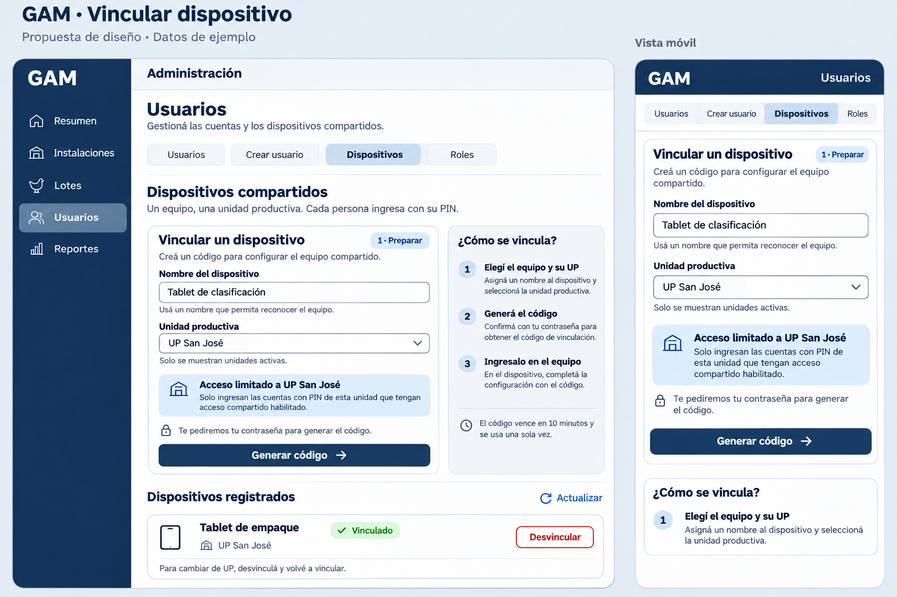
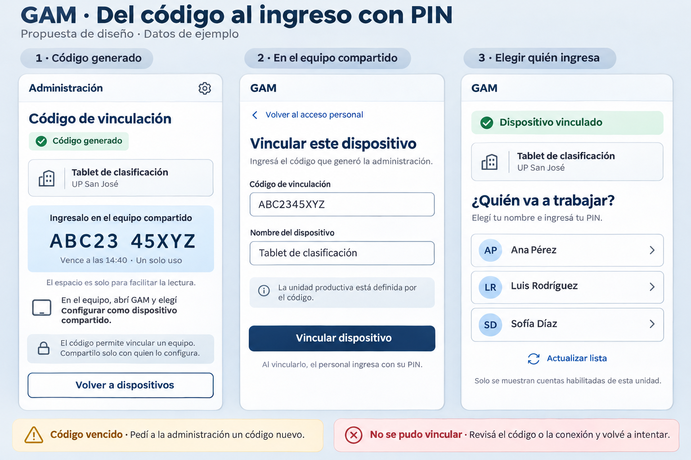

# Vincular dispositivo — propuesta visual

Estado: diseño implementado en Administración y acceso compartido. Rama: `rolesyPermisos`, creada desde `develop` actualizado. Las láminas conservan la propuesta de referencia; ver [la integración](../user-management.md) para el comportamiento entregado.





Los nombres, códigos y horarios son ejemplos. Las imágenes se generaron con la herramienta integrada `image_gen`, sin CLI. El contrato y los tokens del proyecto son la referencia exacta para implementar; los colores del bitmap son ilustrativos.

## Comportamiento propuesto

En **Usuarios → Dispositivos**, Administración ingresa el nombre del equipo y elige una UP activa. La tarjeta explica que solo ingresan las cuentas de modalidad PIN de esa UP, activas, con PIN habilitado y permiso de acceso compartido. Los permisos de trabajo pertenecen al rol de cada persona; no se asignan roles ni permisos al dispositivo.

**Generar código** conserva la confirmación de contraseña del administrador. Al generarlo, la tarjeta muestra el nombre, la UP, el código de diez caracteres y el vencimiento devuelto por el servidor. La agrupación visual del código no modifica su valor. No se anuncia que el dispositivo está vinculado hasta que el canje realmente tenga éxito en el equipo.

En el equipo, **Configurar como dispositivo compartido** abre el formulario de código y nombre. No se elige UP: el código ya la determina. Tras el canje exitoso se muestra el equipo, su UP y el selector de personas. Seleccionar una persona abre el PIN de cuatro dígitos; se conservan los ceros iniciales. La lista solo muestra nombre e identidad visual derivada de ese nombre; no inventa correos ni roles.

Los dispositivos registrados muestran nombre, UP y estado de vinculación. **Vinculado** no significa conectado ni en línea. Si se conservan fechas de actividad, solo se muestran cuando el servidor realmente las informa. Desvincular requiere confirmación de contraseña y explica que termina las sesiones de ese equipo. Cambiar de UP requiere desvincular y volver a generar un código; no se ofrece un editor directo.

## Estados y accesibilidad

- Sin UP activa: explicar que se necesita una UP activa y deshabilitar la generación.
- Cargando unidades o dispositivos: indicador de carga; un fallo ofrece reintento sin simular una lista vacía.
- Validación: nombre obligatorio de hasta 100 caracteres y UP obligatoria; errores asociados a cada campo.
- Confirmación cancelada o contraseña incorrecta: conservar nombre y UP para corregir o continuar.
- Generación o canje en curso: impedir envíos duplicados; no reintentar mutaciones automáticamente.
- Código vencido: ocultar el código y ofrecer generar otro desde Administración. El vencimiento usa `expires_at`.
- Código inválido, usado o vinculación rechazada: mostrar el mensaje del servidor; el equipo no cambia de modalidad local antes del éxito.
- Error de conexión: permitir reintento explícito conservando los datos del formulario.
- Selector vacío: “No hay personas habilitadas para este dispositivo.” y “Actualizar lista”; no ampliar el alcance a otras UP.
- Desvinculación: confirmar equipo y UP y advertir que se cerrarán sus sesiones.
- Vinculaciones antiguas sin UP: informar que deben vincularse de nuevo; no asignarles una UP por inferencia.
- Cambio de identidad, salida del apartado o vencimiento: descartar el código y los borradores sensibles.
- Al reanudar la app o terminar una sesión compartida: limpiar la identidad de la persona y volver al selector, conservando una vinculación válida.

La implementación debe usar los tokens `--gam-color-*` de ambos temas, con `primary/on-primary` para la acción principal, `danger` para desvincular y los pares semánticos de estado. Mantener controles táctiles de al menos 48 px, foco visible, etiquetas y mensajes accesibles. En teléfono, apilar las tarjetas y permitir que `ion-content` gestione el scroll y el teclado. La lámina clara no sustituye la verificación posterior de tema oscuro ni la de dispositivos físicos.

## Contrato revisado

Fuentes locales del backend:

- `../GAM-Backend/docs/implementations/access-methods-and-production-unit-implementation.md`
- `../GAM-Backend/docs/implementations/roles-and-permissions-implementation.md`
- `../GAM-Backend/contracts/openapi/authentication.yaml`

| Operación | Contrato |
| --- | --- |
| Generar código | `POST shared-devices/codes` con `name` y `up_id`; contraseña reciente de Admin. Respuesta: `code`, `expires_at`. |
| Listar equipos | `GET shared-devices`; cada equipo incluye `up_id`. Resolver el nombre con el catálogo autorizado de UP. |
| Canjear en web | `POST auth/web/pairing` con `code` y opcional `device_name`; cookie HttpOnly y CSRF. |
| Canjear en nativo | `POST shared-devices/pairing`; secreto solo en almacenamiento seguro mediante infraestructura existente. |
| Desvincular | `DELETE shared-devices/{id}/pairing`; revoca equipo y sesiones. |

El formulario de Administración envía `name` y `up_id`, y los tipos de dispositivo incorporan la UP, admitiendo las vinculaciones históricas sin asignación. La infraestructura adapta el rol singular recibido para reconocer Admin y admite correo nulo en cuentas PIN. La integración completa de roles, permisos `can_*` y modalidades en los otros módulos y editores de cuentas es un trabajo independiente. La API de estado compartido solo devuelve el ID de UP; en ese equipo se presenta el identificador, mientras Administración muestra el nombre obtenido del catálogo autorizado.

## Validación de esta entrega

Las láminas se contrastaron con el contrato local del backend y posteriormente se implementaron. La revisión en navegador usa las UP reales del entorno local y verifica el formulario, la confirmación y su cancelación sin emitir ni revocar credenciales de dispositivos. El canje, el código generado, la expiración, el selector, el PIN y las respuestas tardías se cubren con pruebas automatizadas. La compilación, lint, suite, auditoría y sincronización nativa se documentan en la guía de gestión de usuarios al finalizar la validación. La verificación en Android/iOS físicos queda pendiente.

## Prompts

### Administración y móvil

```text
Use case: ui-mockup.
Asset type: High-fidelity design proposal for the existing GAM Spanish poultry management app, not an implemented application.
Primary request: Design the device linking admin section with the newly delivered production-unit restriction. Produce ONE sharp wide landscape 2400x1600-ish design board containing two generous responsive views: desktop administration page on left about 66%, phone-width view of the same form on right about 28%. No physical device chrome. Exact natural Rioplatense Spanish typography, perfectly legible, restrained Ionic-style line icons, strong hierarchy, flat 2D UI, no marketing illustrations, no gradients.
Design system: Use light GAM palette exactly: page canvas #eef2f6, surfaces #ffffff, secondary surfaces #f7f9fc, heading/primary navy #17365d, text #334255, muted #5d6e80, decorative border #dce3ea, input border #8091a2, primary soft #dce8f4, success text #176b45 on #e6f5ec, warning #8a5a00 on #fff2d6. Rounded corners 12-16px, controls at least 48px, subtle borders and minimal shadows. Readable clean sans-serif.
Board tiny title top: "GAM · Vincular dispositivo". Subheading: "Propuesta de diseño · Datos de ejemplo".
Desktop UI: narrow navy left navigation sidebar "GAM", items "Resumen", "Instalaciones", "Lotes", "Usuarios" active, "Reportes". Topbar "Administración". Main heading "Usuarios" with subtitle "Gestioná las cuentas y los dispositivos compartidos." Horizontal tabs "Usuarios", "Crear usuario", "Dispositivos" selected, "Roles". Page section heading "Dispositivos compartidos", helper "Un equipo, una unidad productiva. Cada persona ingresa con su PIN."
Main form card titled "Vincular un dispositivo", small pill "1 · Preparar". Intro "Creá un código para configurar el equipo compartido." Two fields vertically: label "Nombre del dispositivo", text value "Tablet de clasificación", help "Usá un nombre que permita reconocer el equipo."; label "Unidad productiva", select value "UP San José" with down chevron, help "Solo se muestran unidades activas." Soft blue informative callout with building outline icon: bold "Acceso limitado a UP San José", copy "Solo ingresan las cuentas con PIN de esta unidad que tengan acceso compartido habilitado." A quiet lock icon line "Te pediremos tu contraseña para generar el código." Footer primary button "Generar código" with arrow-right icon. All complete visible.
Adjacent slim instruction card within desktop content titled "¿Cómo se vincula?" with 3 numbered concise instructions: "1  Elegí el equipo y su UP", "2  Generá el código", "3  Ingresalo en el equipo". Additional quiet text "El código vence en 10 minutos y se usa una sola vez." Keep this separate from form and less prominent.
Below form desktop small section heading "Dispositivos registrados" with "Actualizar" text button. One complete sample device card: tablet outline icon, title "Tablet de empaque", green status "Vinculado", unit line building icon "UP San José", footer text "Para cambiar de UP, desvinculá y volvé a vincular.", outlined red text action "Desvincular". Do not show online status, employee identity, session counts or fabricated capabilities. All visible without cropping.
Right phone-width UI labeled outside "Vista móvil". Compact header "GAM" and "Usuarios", same tabs with "Dispositivos" selected. Title "Vincular un dispositivo". Same form fields, unit help, soft blue UP access callout, password notice and full-width "Generar código". Mobile content stacked with generous spacing, button fully inside safe area. No desktop sidebar in phone view. Optional compact instructions below if space; never shrink text to fit.
Constraints: Distinguish production-unit assignment from functional role permissions. No role selector on device linking, no permission checkboxes, no QR, scanner, email invitations or extra endpoints. No fake real credentials or real identifiers. All sample data marked at board level. Focus on form before code generation.
```

Corrección final sobre la primera lámina:

```text
Preserve layout and Spanish text. Both “Generar código” buttons use solid #17365d with #ffffff text and icons. “Desvincular” uses #a93239 text and border. No other changes.
```

### Recorrido de vinculación

```text
Use case: ui-mockup.
Asset type: High-fidelity Spanish GAM device linking flow proposal board; illustrative screens with example data, not implementation.
Primary request: ONE wide landscape design board, 3 equally prominent portrait app panels in a horizontal sequence, clean flat 2D views without physical device chrome. Board title "GAM · Del código al ingreso con PIN"; tiny subtitle "Propuesta de diseño · Datos de ejemplo". Panel labels outside UI: "1 · Código generado", "2 · En el equipo compartido", "3 · Elegir quién ingresa".
Design system: GAM light palette #eef2f6 canvas, #ffffff surface, #f7f9fc secondary surface, #17365d heading and primary, #334255 body, #5d6e80 muted, #dce3ea card border, #8091a2 input border, #dce8f4 soft blue, success #176b45 on #e6f5ec, error #a93239 on #fdebed. Clean sans-serif, rounded 14px cards, simple outline icons, 48px or greater actions, generous spacing, polished responsive Ionic aesthetic. No gradients or decorative illustrations.
First panel admin UI: compact header "Administración", title "Código de vinculación", success small badge "Código generado". Context card "Tablet de clasificación", building icon "UP San José". Main pale-blue code area label "Ingresalo en el equipo compartido", code "ABC23 45XYZ" in large monospaced groups that together total 10 alphanumeric characters. Label below "Vence a las 14:40 · Un solo uso". Muted helper "El espacio es solo para facilitar la lectura." Instruction small paragraph "En el equipo, abrí GAM y elegí Configurar como dispositivo compartido." Quiet lock notice "El código permite vincular un equipo. Compartilo solo con quien lo configura." Button "Volver a dispositivos" outlined. No copy functionality implied. No regenerate button until expired. Important: no success assertion that another device already linked; only code generated.
Second panel target device UI: small brand "GAM", back link "Volver al acceso personal", title "Vincular este dispositivo", subtitle "Ingresá el código que generó la administración." Fields "Código de vinculación", value "ABC2345XYZ"; "Nombre del dispositivo", value "Tablet de clasificación". Helper "La unidad productiva está definida por el código." Primary full-width action "Vincular dispositivo". Below neutral helper "Al vincularlo, el personal ingresa con su PIN." Do not show UP selector here, no manual changing of UP, no employee identity before successful linking.
Third panel after successful linking: small brand "GAM", quiet green check text "Dispositivo vinculado", context "Tablet de clasificación" and "UP San José". Title "¿Quién va a trabajar?", subtitle "Elegí tu nombre e ingresá tu PIN." Three clean full-width selectable rows with avatar initials, names "Ana Pérez", "Luis Rodríguez", "Sofía Díaz", chevron. Text action "Actualizar lista". Quiet small note "Solo se muestran cuentas habilitadas de esta unidad." No employee roles or emails because selector API only returns ID and name. Do not show PIN keypad in same state; selection precedes PIN input.
At board bottom two compact clear state notes outside app frames, large enough to read: warning "Código vencido · Pedí a la administración un código nuevo." and error "No se pudo vincular · Revisá el código o la conexión y volvé a intentar." These are alternate states, not simultaneous errors displayed in successful screens.
Constraints: all three complete panels entirely visible; no cropping. Never show role selection, permission toggles, QR code, camera, a fabricated automatic code-consumed tracking indicator, or a live online badge. Sample time and names are illustrative. Precise legible Spanish accents.
```

